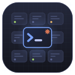
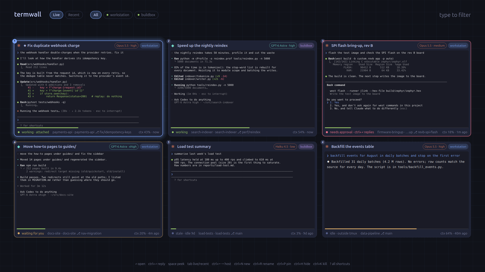
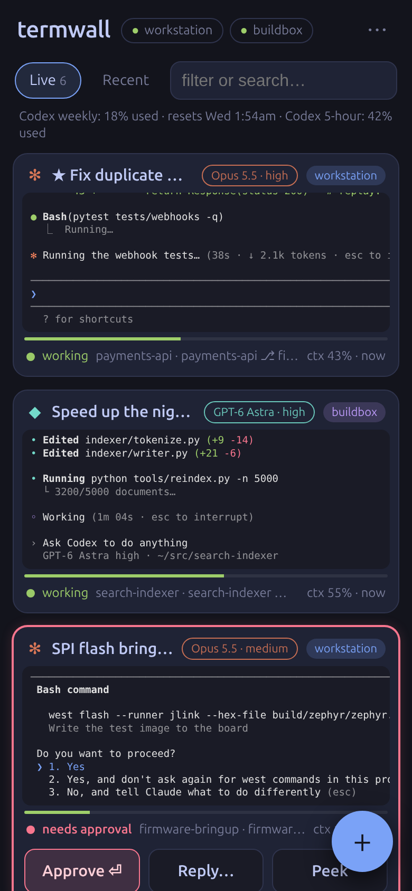

# termwall

One hotkey shows every Claude Code and Codex session you have running, on
every machine, as a grid of live terminal cards. Each card says whether the
agent is working, finished and waiting for you, or blocked on an approval
prompt. Pick a card and it opens in a real terminal. A phone app shows the same
wall and sends a push notification when an agent needs an answer while you are
away from the desk.



*The screenshots show invented sessions. They are rendered by the real widget
and the real web client from the fixture data in `demo/fixtures.py`
(see [Demo and screenshots](#demo-and-screenshots)); no real session, path or
hostname appears in them.*

## What it does

- **One wall for all hosts.** tmux sessions, Claude Code sessions and Codex
  sessions from the local machine and from any number of ssh hosts, merged into
  one most-recently-used list. Hotkey then Enter flips between your last two
  sessions.
- **Status per session.** Green *working*, amber *waiting for you* (the agent
  finished a turn since you last opened it), red *needs approval* (a
  permission, confirm or password prompt is on screen), grey *idle* or *stale*.
- **Approval prompts.** A blocked session raises a desktop notification with an
  Open button. `Ctrl+Enter` on the wall types a reply into that session; an
  empty reply sends Enter.
- **Context meter.** A bar and `ctx 43%` on each card: tokens in context after
  the last reply against the model's window.
- **Model and git.** Model and effort chip, `repo ⎇ branch`, and "(2 in repo)"
  when several sessions share a repository.
- **Transcript search.** Typing filters cards by title, folder, host and model;
  three or more letters also search the text of the last 60 days of transcripts
  on every host.
- **Resume.** The *Recent* tab lists ended sessions. Enter starts
  `claude -r <id>` or `codex resume <id>` in a new tmux session in the right
  directory. If that conversation is already running, the running one is opened
  instead.
- **Reboot recovery.** termwall remembers each host's tmux sessions and boot
  time. When a host comes back with a new boot time, the missing sessions are
  recreated and their agents resumed. A session you quit on purpose is not
  brought back.
- **Phone app.** `termwall web` serves the wall as an installable web app with
  a real terminal (xterm.js on a pty running `tmux attach`), approve and reply
  buttons, and Web Push.



## Keys

```
Ctrl+Alt+Space            summon / dismiss (GNOME custom shortcut)
? or F1                   the full shortcut sheet
Enter / click             open (focuses the session's kitty tab)
1-9                       open card N          type   filter (title, dir, host, model, transcripts)
Ctrl+Enter                quick reply (empty = just press Enter, e.g. to answer a prompt)
Space / right-click       peek: live screen, arrows and PgUp/PgDn scroll back
Tab                       Live <-> Recent (ended sessions; Enter resumes in tmux)
Ctrl+Left/Right           filter by host
Ctrl+N new   Ctrl+R rename   Ctrl+P pin   Ctrl+H hide   Ctrl+K twice: kill
```

## How it works

```
 workstation (daemon, Qt overlay) ──local subprocess──▶ agent.py ─┐
            │                     ──ssh (ControlMaster)─▶ agent.py ─┤ buildbox, laptop…
            │                                                       │
            │   one JSON snapshot per line every 1 s (3 s when hidden):
            │   tmux sessions + screen captures (sent only when changed),
            │   Claude sessions (~/.claude/sessions/<pid>.json + transcripts),
            │   Codex sessions (running `codex` + ~/.codex/sessions rollouts),
            │   recent ended sessions for resume
            │   commands go back over the same pipe: new / kill / rename / send
            ▼
 kitty (own instance, own socket): one tab per session, `ssh -t host tmux attach`
```

- **`agent.py` needs nothing installed on the remote.** It is one file of
  standard-library Python (3.8+, 1,076 lines). On every connect it is sent
  inline as `python3 -c <base64>` over ssh, so a remote host needs only
  `python3` and `tmux`. The agent is never installed or saved on the remote.
  The only file it writes there is a small prefs file, and only on the host
  you choose to hold the shared pins.
- **Sessions live in tmux**, so they survive disconnects and can be opened from
  any machine. A session started outside tmux still appears, with its latest
  transcript text and status, but cannot be attached; quit it there and resume
  it from *Recent*.
- **Status** comes from Claude's own session file, Codex's rollout events, an
  "esc to interrupt" check on the captured screen, and a pair of regular
  expressions for approval dialogs and shell prompts. Prompt detection only
  looks at the last lines of the screen, so an answered `[Y/n]` that has
  scrolled up, or an agent merely talking about prompts, does not count. The
  tests in `tests/test_model.py` cover 7 blocked shapes and 4 quiet ones.
- **The store** (`model.py`) merges per-host snapshots into session cards and
  keeps the small persistent state: last opened, last seen, pins, hidden,
  remembered sessions per boot.
- **The overlay** (`overlay.py`) is one custom-painted Qt widget. Terminal
  thumbnails are rendered from `tmux capture-pane -e` output by a small SGR
  parser (`render.py`).

## Supported platforms

| Part | Supported | Notes |
|---|---|---|
| Overlay and daemon | Linux, GNOME on X11 | The overlay is an override-redirect X11 window and uses python-xlib to place and focus the terminal. The hotkey is installed through `gsettings`, the daemon as a systemd user service, the tray through the AppIndicator extension. **Wayland is not supported.** |
| Hosts being watched | Linux and macOS | Needs `python3` (3.8+), `tmux`, and key-based ssh from the overlay machine. |
| Phone app server | Linux (systemd) and macOS (launchd) | Can run on a different, always-on host than the overlay. |
| Overlay on macOS | Not supported | PySide6 runs there, but there is no hotkey integration and the Terminal.app launcher is untested. |
| Terminal | kitty, or any command | `kitty` gets one dedicated window with a tab per session. `terminal.kind = "command"` runs a template such as `gnome-terminal -- {cmd}`. |

This was built for and used on one setup: an Ubuntu desktop as the overlay
machine and a Mac as a remote host and phone-app server. Other combinations
are untested.

## What termwall can do to your sessions

termwall is a selector, but it is not read-only, so this is stated plainly:

- It starts agents by typing a command into a new tmux session. The commands
  come from `[agents]` in the config and default to plain `claude`,
  `claude -r {id}`, `codex` and `codex resume {id}`.
- **There is no permission-bypass option.** Nothing in the source adds
  `--dangerously-skip-permissions`, `--full-auto` or any similar flag, and no
  setting turns one on. If you want agents started that way, you must write
  the flag into `[agents]` yourself; that is opt-in, off by default, and
  applies to every session termwall starts or resumes, including the ones
  recreated after a reboot.
- It never answers a prompt on its own. Approving from the wall or the phone is
  an action you take per prompt: it sends Enter (or the text you typed) to that
  one tmux session.
- It can kill a tmux session (Ctrl+K twice, or the phone's action sheet with a
  confirmation). The conversation stays resumable.
- The shell hook (`termwall install-shell`) wraps `claude` and `codex` so they
  start inside tmux. It passes your arguments through unchanged.

## Phone app

`termwall web` serves the same cards: live terminal tails, status, model,
context. Tap for a terminal with an Esc/Tab/Ctrl-C/arrow key bar, long-press
for peek, reply, rename, pin and kill, **+** for a new session.

Security model, because this server can type into your shells:

- It listens on **127.0.0.1 only**. It is meant to be published to your own
  devices with `tailscale serve` (HTTPS, tailnet devices only), which is also
  what makes it installable and able to receive push.
- Every API and WebSocket call needs a pairing token (32 random URL-safe
  characters, stored mode 0600). The static app shell is the only thing served
  without it.
- A phone gets the token by entering a 6-digit code printed by
  `termwall web-pair`. The code is valid for 10 minutes and dies after 5 wrong
  tries.
- The request log records method and path, never the query string, because
  WebSocket URLs carry the token.
- Push payloads contain the host, the session name and the session key, nothing
  from the conversation.

```sh
# on the server host
termwall install-web                 # systemd user service, or launchd on macOS
tailscale serve --bg --https=443 http://127.0.0.1:8770
termwall web-pair https://<host>.<your-tailnet>.ts.net
```

Web Push needs a VAPID subject that the push services accept. The default in
`webpush.py` is the placeholder `mailto:termwall@example.net`; set
`vapid_subject` under `[web]` in the config to an address you control. The
VAPID key pair is generated on first run and stored next to the config, mode
0600. Phone alerts can alternatively go through [ntfy](https://ntfy.sh): the
tray menu creates a random topic for you.

## Install and run

```sh
uv tool install --editable .     # puts `termwall` on PATH
termwall install-shell           # claude/codex start inside tmux on every configured host
termwall install                 # Ctrl+Alt+Space hotkey + systemd user service
termwall                         # start the daemon and show the overlay
```

Config is `~/.config/termwall/config.toml`, written with defaults on first run.
List your machines there:

```toml
[[hosts]]
name = "workstation"        # the machine the overlay runs on

[[hosts]]
name = "buildbox"
ssh = "buildbox"            # user@host, or a Host alias from ~/.ssh/config
```

`termwall restart` after editing. Other commands: `status`, `logs`, `quit`,
`uninstall`, `screenshot FILE.png`.

## Demo and screenshots

The UI can be run from fixture data without touching a real setup:

```sh
uv run python demo/render_overlay.py docs/overlay.png      # offscreen Qt, no window
uv run python demo/serve_web.py --port 8791                # phone app on 127.0.0.1
```

`render_overlay.py` builds the real `Overlay` widget on Qt's offscreen
platform, loads the invented sessions through the normal `Store.ingest` path,
and grabs the widget to a PNG. `serve_web.py` runs the real web server with
host connections replaced by a no-op and the same fixtures. Both keep config
and state in a temporary directory, start no daemon and contact no host.
`docs/phone.png` is a headless-Chrome capture of that server at 390x844.

What the screenshots do not show: the terminal a card opens into, the
notification, and the phone's terminal view. Those need live tmux sessions.

A second instance can also be driven end to end without a display, with its
own runtime and config directories:

```sh
export QT_QPA_PLATFORM=offscreen XDG_RUNTIME_DIR=/tmp/tw XDG_CONFIG_HOME=/tmp/twcfg
termwall daemon &   termwall show;  termwall key type:reply ctrl+Return type:yes Return
termwall debug;     termwall screenshot /tmp/x.png
```

## Tests

```sh
uv run pytest
```

46 tests collected from 33 test functions (some parametrised), all passing on
Linux with Python 3.13. `tests/conftest.py` selects Qt's offscreen platform and
points the config directory at a temporary one, so the suite does not touch a
real `~/.config/termwall`.
They cover the transcript parsers for both agents, prompt detection, status
transitions, reboot restore, pin/hide/order, transcript search, the config
writer, the SGR parser, and the web server's token checks (every API and
WebSocket route refuses a missing or wrong token; no path traversal).

Not covered by tests: the painted overlay, the kitty and X11 integration, ssh
transport, the launchd/systemd installers, and Web Push delivery.

## Layout

```
src/termwall/
  agent.py          host agent: stdlib only, sent inline over ssh       1,076 lines
  overlay.py        the overlay widget, custom painted                  1,277
  webserver.py      phone app API, state WebSocket, terminal bridge       631
  cli.py            commands, installers (GNOME hotkey, systemd, launchd) 432
  app.py            daemon: host connections, notifications, control socket 430
  model.py          store: merge snapshots, status, ordering, reboot memory 409
  tray.py           tray icon and quick settings                          244
  render.py         capture-pane (SGR) to image                           178
  launcher.py hosts.py config.py webpush.py presence.py x11.py theme.py
  web/              phone client: app.js (507 lines), sw.js, app.css, index.html
  web/vendor/       xterm.js and its fit addon (MIT, see THIRD-PARTY-NOTICES.md)
  shell/            the bash/zsh hook and a default tmux.conf
tests/              pytest suite
demo/               fixture sessions and the two screenshot scripts
docs/               icon and screenshots
```

5,396 lines of Python and 762 lines of web client under `src/`, 505 lines of
tests.

## Limits and what is not included

- X11 only for the overlay; no Wayland.
- Sessions running outside tmux can be seen but not opened.
- tmux sizes a window to its most recently active client, so typing into a
  session from the phone narrows it on the desktop until you use it there
  again.
- Claude Code does not log its context window size, so the context meter for
  Claude uses `claude_context` from the config (default 1,000,000).
- Status and prompt detection read the terminal screen and the agents'
  on-disk session files. Those formats are not a stable interface; a new agent
  release can break detection until the patterns are updated.
- The original screenshot of the tool in use is not included because it showed
  real sessions. The fixture renders replace it.
- No packaging beyond `uv tool install`; no releases.

## Licence

MIT, see `LICENSE`. Copyright 2026 Eamon White. The vendored xterm.js files
keep their own MIT licence, see `THIRD-PARTY-NOTICES.md`.
